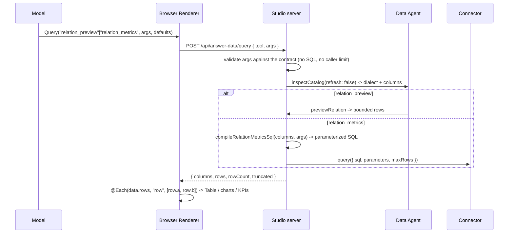

# OpenUI Live Data: Answer Data Plane

> **Proposed architecture.** This document defines how OpenUI 1.0 `Query()` /
> `Mutation()` should be introduced into Tessera Studio. It is an insertion
> plan, not a description of shipped behavior. Nothing here authorizes relaxing
> the current rule that a browser request never carries raw SQL.

Status: partly implemented
Scope: Studio (`apps/studio`), OpenUI answer library, Data Agent read path, `TesseraDatabaseActionService` write path
Depends on: `@openuidev/lang-core` / `@openuidev/react-lang` 1.0.1, `docs/architecture/ultimate-agent-data-permission.md`

> **Implemented so far (read + write answer data plane).** Both halves are live
> and laid out in clear layers. Server: `src/answer-data/` — `contracts.ts` (wire
> schemas, result types, error), `read.ts` (`relation_preview`,
> `relation_metrics`, metrics SQL compiler), `write.ts` (catalog envelope +
> governed submit), `index.ts`. Prompt: `src/generative/openui-answer-tools.ts`
> (tool specs derived from the contracts) and `openui-answer-prompt.ts`
> (`compileAnswerPrompts()` -> read-only / read-write). Transport:
> `server.ts` routes `POST /api/answer-data/{query,action}`. Client:
> `use-answer-tool-provider.ts` / `use-answer-database-action.ts` /
> `answer-approval*.ts(x)` / `analysis-view.tsx`. Still planned: the answer-scoped
> binding manifest and the semantic `semantic_query` read path. See §19.

## 1. Executive decision

OpenUI 1.0 lets a generated program fetch and mutate data **from the browser at
render time**: `Query(tool, args, defaults, refreshSeconds?)` caches, refetches,
and rebinds to `$variables`; `Mutation(tool, args)` plus `@Run(...)` fires writes
and invalidates queries. This is the single biggest capability we have not used,
and it is a perfect fit for a database product: the answer stops being a
snapshot and becomes a live view.

It is also a new execution surface. Today the browser can only read a
catalog-constrained table preview (`GET /api/data/:schema/:table`) and submit
typed database actions (`POST /api/database-actions`); it never authors SQL. If
we expose OpenUI tools naively, model-authored arguments return to the browser
and come back, and the browser becomes an input to database execution.

The decision is to insert a thin, server-authoritative layer — the **Answer Data
Plane** — between the rendered program and the existing Data Agent /
Capability Broker paths:

1. The model is taught a **closed set of structured tools** (identifiers,
   metrics, filters), never SQL.
2. The browser calls `POST /api/answer-data/query` and `POST
   /api/answer-data/mutation` through a function-map `toolProvider`.
3. The server **re-validates every argument** against the live catalog, the
   active grant set, and the current policy, compiles parameterized SQL
   server-side, and executes through the existing boundaries.
4. Reads fail closed unless `sqlStatements.read === "allow"`. Writes always go
   through `TesseraDatabaseActionService` and may return an approval checkpoint.
5. An **answer-scoped binding manifest** pins the exact validated plans to the
   rendered program before writes are enabled.

The invariant is one sentence: *the browser may choose among capabilities the
server already projected into the answer, and nothing else.*

## 2. Goals and non-goals

### Goals

1. Let a generated answer render live rows, aggregates, and KPIs that refresh on
   `$variable` changes and after a mutation.
2. Keep the browser out of the SQL-authoring trust path.
3. Reuse the Data Agent compiler and policy, and the database-action
   approval/effect machinery, rather than building a parallel one.
4. Reuse OpenUI's own loading/error/retry surface instead of inventing one.
5. Persist and restore the interactive state (`$variables`, form fields) so a
   live answer survives reload.
6. Make cost bounded and observable: per-answer query budget, row caps,
   timeouts, cache TTLs.

### Non-goals

- No raw SQL from the browser, ever, in either direction.
- No client-side policy decision. A UI toggle is never authorization.
- No `dangerous` posture selectable from the browser.
- No MCP transport and no model-authored tool loader.
- No change to the current server-side Agent tool contract (`list_database`,
  `search_data_context`, `prepare_analysis`, `execute_sql`).

### Invariants

| # | Invariant |
| --- | --- |
| I1 | Every answer-data request carries only structured arguments; `sql` / `parameters` are rejected at the schema boundary. |
| I2 | Reads compile server-side from validated arguments into parameterized statements. |
| I3 | `sqlStatements.read !== "allow"` ⇒ every read is denied (fail closed, matching `readApprovalUnsupported`). |
| I4 | Mutations are submitted only through `TesseraDatabaseActionService`, with approval when policy says `ask`. |
| I5 | Identity/tenant is resolved from the request context, never from the body. |
| I6 | Every plan is bound to a catalog fingerprint; a stale catalog rejects instead of guessing. |
| I7 | Responses never contain SQL, credentials, or native driver errors. |
| I8 | Browsers cannot exceed the per-answer query/row/time budget. |

## 3. What OpenUI 1.0 actually gives us

Verified against the installed 1.0.1 type surface.

### Query

```
identifier = Query("tool_name", { args }, { defaults }, "30")
```

- Positional: `(toolName, args, defaults, refreshSeconds?)`
  (`QueryStatementInfo.toolAST / argsAST / defaultsAST / refreshAST`).
- The runtime evaluates `args` with `$variables` substituted, then calls the
  provider. The cache key is `statementId + evaluated deps`; `refreshInterval`
  re-fetches on a timer; `@Run(queryRef)` refetches on demand.
- `defaults` render immediately, before the first fetch resolves, and stay
  visible during a refetch (no flicker).
- Built-ins compose only over query data: `@Count`, `@Sum`, `@Avg`, `@Filter`,
  `@Sort`, `@Each`, `@Round`, …

### Mutation

```
createResult = Mutation("tool_name", { ... })
saveBtn = Button("Save", Action([@Run(createResult), @Run(rows)]))
```

- A mutation is a reference; it only runs inside an `Action([...])` plan via
  `@Run`. `MutationResult.status` is `idle | loading | success | error`.
- `@Run(queryRef)` in the same plan invalidates/refetches the named query
  (`fireMutation(statementId, args, refreshQueryIds)`), which is exactly the
  "write then refresh the dashboard" flow.

### Provider contract

```ts
type ToolProvider =
  | Record<string, (args: Record<string, unknown>) => Promise<unknown>>
  | McpClientLike;
```

- A function map is normalized by the Renderer; a missing tool name throws
  `ToolNotFoundError`.
- `RendererProps.toolProvider`, `queryLoader`, `onError`, `onStateUpdate`,
  `initialState`, `onParseResult` are all available.

### Render slots

`Renderer.Root` owns one runtime; `Renderer.Content` keeps generated components
mounted while queries load or fail; `Renderer.QueryLoading` shows while fetching
unless a failure is displayed; `Renderer.QueryError` shows on failure and renders
nothing without children; `Renderer.Retry` is a real button that can be vetoed
with `preventDefault()`. `useRendererQuery()` exposes
`{ isLoading, errors, retry, isRetrying }`.

### Prompt

Passing `tools: ToolSpec[]` (with `toolExamples`) to `generateSystemPrompt`
switches the prompt into the Data Workflow: it teaches `Query()` for reads,
`Mutation()` for writes, `$variables` + `$binding` props, `@Run`, and the
`@`-builtins, and prints a "Default values for Query results" block. Tool
annotations (`readOnlyHint`, `destructiveHint`) travel with the spec.

## 4. The trust boundary problem

The naive wiring is one line — pass a `toolProvider` that hits the DB — and it
is wrong three ways:

1. **Authority.** Model-authored `args` are relayed by the browser. Without
   re-validation, the browser is an input to execution. Any authenticated
   client could post a crafted body.
2. **SQL surface.** The obvious read tool is "run this SQL". That reintroduces
   exactly what the current transport forbids, and widens the read surface for
   every authenticated client, not just the model.
3. **Cost and availability.** A live answer with a 5-second refresh and no
   budget is a query flood.

The Answer Data Plane answers all three: structured tools only, server-side
compilation and policy, and explicit budgets/bindings.

## 5. Architecture

```mermaid
flowchart LR
  M[Model] -->|authors openui-lang| HOST[Studio host]
  HOST -->|program + tool teaching| BROWSER[Browser Renderer]
  BROWSER -->|Query / Mutation via toolProvider| API[/api/answer-data/*]
  API --> VALIDATE[Arg validation + catalog bind]
  VALIDATE --> POLICY[Read policy / grant set]
  POLICY --> COMPILE[Server-side compiler]
  COMPILE --> DA[Data Agent connector]
  POLICY -. ask .-> ACTIONS[TesseraDatabaseActionService]
  ACTIONS --> BROKER[Capability Broker + approval]
  DA --> API
  BROKER --> API
  API --> BROWSER
```

### 5.1 Components

| Component | Responsibility | Lives in |
| --- | --- | --- |
| Tool contract | Names, zod arg schemas, `ToolSpec` for the prompt | `apps/studio/src/generative/openui-data-tools.ts` (React-free) |
| Answer Data service | Validate, bind to catalog, compile, execute, budget | `apps/studio/src/answer-data.ts` (new) |
| Preview compiler | Shared SQL builder extracted from the current route | `apps/studio/src/answer-data-preview.ts` (new) |
| HTTP surface | `POST /api/answer-data/query`, `/mutation` | `apps/studio/src/server.ts` |
| Client provider | Function-map `toolProvider`, error mapping | `apps/studio/src/client/components/generative/use-answer-tool-provider.ts` (new) |
| Render slot host | `Renderer.Root` + slots + `onError` + `initialState` | `apps/studio/src/client/components/generative/analysis-view.tsx` |
| Prompt assembly | Inject `tools` / `toolExamples` | `apps/studio/scripts/generate-openui-prompt.ts` |

### 5.2 Single source of truth for tools

The zod schema for each tool's args is the **only** definition. The prompt's
`ToolSpec.inputSchema` is derived from it, and the server validates with the same
schema. A tool can therefore never be taught without being enforced, mirroring
the existing rule that the component library and the answer prompt come from one
place.

## 6. Tool taxonomy

### 6.1 Read tools (Phase 2)

**`relation_preview`** — catalog-constrained rows. This is the live version of
the existing `GET /api/data/:schema/:table`, and reuses its SQL builder.

```ts
{
  schema: string,
  table: string,
  page?: number,            // >= 1
  pageSize?: number,        // <= 100 (TABLE_PREVIEW_MAX_ROWS)
  sort?: { column: string, direction: "asc" | "desc" },
  filters?: Array<{ column: string, operator: "equals" | "not_equals" | "contains"
      | "gt" | "gte" | "lt" | "lte" | "is_null" | "is_not_null", value?: string | number | boolean }>,
  search?: string,
}
```

Returns `{ columns, rows, totalRowCount, page, pageSize, truncated }`.
Every identifier is validated against the catalog table; columns are capped at
`DATA_AGENT_RELATION_PREVIEW_MAX_COLUMNS` (64).

**`relation_metrics`** — grouped aggregates for charts and KPIs.

```ts
{
  schema: string,
  table: string,
  groupBy?: string[],                       // <= 2 columns
  metrics: Array<{ fn: "count" | "sum" | "avg" | "min" | "max",
                   column?: string, alias?: string }>,   // <= 4
  filters?: Array<...same as preview...>,
  orderBy?: { alias: string, direction: "asc" | "desc" },
  limit?: number,                           // <= 1000
}
```

Returns `{ columns, rows, truncated }`. Compiled into a parameterized
`SELECT <groupBy>, <aggregates> ... GROUP BY ... ORDER BY ... LIMIT ...` with
identifiers quoted by dialect and values parameterized, using the same
`coercePreviewParameter` rules as the preview route.

### 6.2 Mutation tool (Phase 4)

**`catalog_action`** — one typed, catalog-bound action. The model never names a
raw operation; the capability projection decides what is callable.

```ts
{
  action: DatabaseMutationAction,     // existing typed schema
  purpose: string,                    // <= 1000 chars
  idempotencyKey?: string,
}
```

The tool list itself is projected from
`databaseActions.capabilities({ actor })` → `ModelVisibleGrantSet`. The prompt
only advertises mutation support when `accessMode === "read-write"` and
`databaseActionsAvailable`, matching `resolveAgentPermissions`.

### 6.3 Optional later tool (Phase 5)

**`semantic_query`** — entity/field/metric names from the semantic catalog,
compiled by the Data Agent. Requires a **re-runnable** variant of
`prepareAnalysis` (today `analysisRef` is one-shot by design); see §12.

## 7. Server design

### 7.1 Routes

```
POST /api/answer-data/query      { tool, args, deps? }        -> result
POST /api/answer-data/mutation   { action, purpose, ... }     -> effect | pending_approval
```

Both are wrapped in `withStudioRouteRuntime` exactly like the existing routes,
so they get the same runtime lease, identity, and logging.
`studioApiOperation()` gains `answer_data_query` / `answer_data_mutation`.

### 7.2 Request pipeline

```
1. Authenticate: context.get("identity")            (I5)
2. Resolve runtime + dataAgent + connector
3. Reject unknown tool                              (closed set)
4. Validate args with the shared zod schema         (I1)
5. Load catalog; verify fingerprint and table/column (I6)
6. Policy gate:
     read  -> sqlStatements.read === "allow" else deny (I3)
     write -> accessMode === "read-write" and databaseActionsAvailable
7. Compile parameterized SQL server-side            (I2)
8. Enforce budget: per-answer query count, rows, timeout
9. Execute via runtime.connector.query / dataAgent
10. Return a trimmed DTO; map errors to stable codes (I7)
```

### 7.3 Reads

Reuse the Data Agent/connector boundary rather than opening a new one:

- `relation_preview` → the extracted preview builder + `runtime.connector.query`
  with `purpose: "Tessera answer preview"` and `maxRows: pageSize`.
- `relation_metrics` → the new aggregate builder + `runtime.connector.query`
  with `purpose: "Tessera answer metrics"` and `maxRows: limit`.
- MongoDB keeps its `{ kind: "mongodb", pipeline }` path, reusing the existing
  `buildMongoTablePreviewMatch` logic.

For Phase 5, `semantic_query` routes through `dataAgent` instead.

### 7.4 Writes

`catalog_action` calls `runtime.databaseActions.submit({ actor, action, purpose,
requireApproval, idempotencyKey })`. Two outcomes:

- **Completed** → return the effect summary (safe fields only) as the mutation
  result, with the `requestId`.
- **`awaiting-approval`** → return `{ status: "pending_approval", requestId,
  checkpointId, operation, target, purpose, compiled? }` as the mutation result.
  The browser does **not** render this inside the program; the host renders
  approval chrome and calls the existing
  `POST /api/database-actions/:requestId/approval`, then `@Run(queryRef)`.

This keeps one approval implementation and one effect ledger.

### 7.5 Budgets, caching, and limits

| Knob | Default | Enforced in |
| --- | --- | --- |
| `maxQueriesPerAnswer` | 12 | Answer Data service, keyed by `(threadId, messageId)` |
| `maxRows` | 100 (preview), 1000 (metrics) | compiler + connector |
| `timeoutMs` | connector default | `AbortSignal` from the request |
| `cacheTtlMs` | 5–15s | `AbortResilientCache` from `@open-tessera/database` |
| `maxConcurrent` | e.g. 4 per thread | service |

Cache key: `(catalogFingerprint, planHash, canonicalDepValues)`. A catalog
change therefore invalidates automatically because the fingerprint moves.

## 8. Client design

### 8.1 Provider

A hook builds a stable function map so the Renderer never re-creates its runtime:

```ts
const toolProvider = useAnswerToolProvider({ threadId, messageId });
// { relation_preview: (args) => postQuery("relation_preview", args, deps),
//   relation_metrics: (args) => postQuery("relation_metrics", args, deps),
//   catalog_action:   (args) => postMutation(args) }
```

Errors are normalized to a small shape the UI can render
(`{ code, message, retryable }`), never a raw HTTP body.

### 8.2 Render host

`analysis-view.tsx` moves from a bare `<Renderer>` to slot composition:

```tsx
<Renderer.Root
  library={shadcnChatLibrary}
  response={response}
  isStreaming={isStreaming}
  toolProvider={toolProvider}
  initialState={initialState}
  onStateUpdate={onStateUpdate}
  onError={onError}
  onAction={onAction}
>
  <div className="tessera-analysis-relative">
    <Renderer.Content />
    <Renderer.QueryLoading><AnswerDataSpinner /></Renderer.QueryLoading>
    <Renderer.QueryError>
      <div role="alert">
        We could not load live data.
        <Renderer.Retry>Retry</Renderer.Retry>
      </div>
    </Renderer.QueryError>
  </div>
</Renderer.Root>
```

The existing post-stream classification in `analysis-view.tsx` (`root`,
`rootExpression`, `statementCount`) stays; a program with `Query()` statements
parses to a root tree, so it is already treated as renderable.

### 8.3 Persistence

- `onStateUpdate(state)` → persist per-message `$variables` / form state through
  the existing session memory.
- `initialState` → restore on reload. Prefer OpenUI's message protocol
  (`buildMessage` / `parseMessage`) so context and content travel together; the
  Renderer already accepts a stored message as `response`.

### 8.4 Invalidation and refresh

The program owns this: `Action([@Run(mutRef), @Run(dataRef)])`,
`refreshInterval` on `Query`, and `@Set($filter, …)` for interactive filters.
The host only has to make sure the post-approval path also refetches — either the
model includes `@Run(dataRef)` in the plan, or the host invalidates the
`useRendererQuery()` retry after an approval completes.

## 9. Prompt teaching

`scripts/generate-openui-prompt.ts` gains:

```ts
const prompt = generateSystemPrompt({
  library: shadcnChatLibrary.toSpec(),
  promptOptions: {
    ...shadcnPromptOptions,
    tools: OPENUI_ANSWER_DATA_TOOLS,       // ToolSpec[] from openui-data-tools.ts
    toolExamples: OPENUI_ANSWER_DATA_EXAMPLES,
  },
});
```

When `tools` is present, `toolCalls` defaults on and the generated prompt
switches to the Data Workflow automatically; `bindings` follow. Keep the
tool list short and stable: `relation_preview`, `relation_metrics`, and (only in
read-write) `catalog_action`. Examples should show the canonical patterns:

```
rows = Query("relation_preview", { schema: "public", table: "orders", pageSize: 20 }, { rows: [] })
statusFilter = $status ? [{ column: "status", operator: "equals", value: $status }] : []
chart = Query("relation_metrics", { schema: "public", table: "orders",
  groupBy: ["status"], metrics: [{ fn: "count", alias: "count" }] }, { rows: [] })
```

The prompt is regenerated in `dev`/`build` as today, so an unreachable tool
cannot be taught without failing the build.

## 10. Data model

| Record | Key | Contents | TTL |
| --- | --- | --- | --- |
| Answer data binding (Phase 3) | `bindingId` | tool, args template hash, dep paths, plan hash, catalog fingerprint, grant-set version | answer lifetime |
| Query budget | `(threadId, messageId)` | count, first/last used | message lifetime |
| Effect / approval | `requestId` | existing `TesseraDatabaseActionService` ledger, unchanged | existing |
| Message state | `(threadId, messageId)` | `$variables`, form state | thread lifetime |

The binding manifest is written when the program is projected and is **not**
trusted from the browser; it is only matched.

## 11. Security and approval

### 11.1 Threat model

| Threat | Mitigation |
| --- | --- |
| Crafted body executes arbitrary reads | Structured args only; catalog + policy validation; I1–I3 |
| Browser smuggles SQL | Schema rejects `sql`/`parameters`; compile server-side |
| Meme of a denied tool | Tool list projected from the grant set; server re-checks anyway |
| Approval replay / double effect | Existing effect ledger + idempotency key; single submission path |
| Foreign-thread binding reuse (Phase 3) | Binding scoped to `(tenant, threadId, messageId)` |
| Query flood | Per-answer budget, concurrency cap, cache, timeout |
| Stale catalog after approval | Fingerprint re-check; reject, do not rebind silently |
| Sensitive column disclosure | Catalog-aware column allowlist/redaction before DTO |

### 11.2 Approval reuse

Approval is not reimplemented. The browser shows the same checkpoint the Agent
tool path uses, through the existing `TesseraToolCall` approval surface
(`approveStudioDatabaseAction` / `rejectStudioDatabaseAction`). The only new
thing is that the checkpoint also arrives as a `Mutation()` result, so the
answer can render a "waiting for approval" state.

## 12. Optional deeper read path (Phase 5)

For semantic, RLS-aware live reads, generalize the existing prepared analysis
into a re-runnable **live analysis**:

- Data Agent gains `prepareLiveQuery(input)` returning `{ liveRef, columns,
  defaults, parameterSlots }` with a TTL, keeping the one-shot
  `preparedAnalyses` path untouched.
- `parameterSlots` lets `$variable`-bound filters re-bind without recompiling.
- The browser calls `Query("semantic_query", { ref, params })`; the server
  re-validates `params` against the slots and executes the stored plan.

This is the only way to keep reads semantically bound rather than
relation-level. It is deliberately last, because `relation_preview` and
`relation_metrics` already cover the "live dashboard" use case with far less new
surface.

## 13. Observability and failure handling

- Emit `answer_data.query.started/completed/failed`,
  `answer_data.mutation.submitted/pending/approved/rejected/failed`,
  `answer_data.budget.exceeded` through `studio-logger`, with `tenantRef`,
  `actorRef`, `threadId`, `messageId`, `tool`, `planHash`, `durationMs`.
- Never log or return raw SQL, parameters, credentials, or native errors.
- `Renderer.onError` receives structured `OpenUIError[]`; log them with the
  `severity` field intact and surface only retryable ones to the reader.

Failure → UX mapping:

| Condition | Server | UI |
| --- | --- | --- |
| Read denied by policy | 403 `read_not_authorized` | Stable alert, no regenerate |
| Catalog stale | 409 `catalog_stale` | `QueryError` + Retry |
| Timeout | 504 `answer_data_timeout` | `QueryError` + Retry |
| Unknown tool / bad args | 400 `invalid_answer_data_request` | `onError`, keep defaults |
| Budget exceeded | 429 `answer_data_budget_exceeded` | Disable refresh, show notice |
| Mutation pending | 202 `pending_approval` | Host approval chrome |

## 14. Phased rollout

### Phase 0 — spike (read-only, one tool)

- Add `openui-data-tools.ts` with `relation_preview`.
- Add a throwaway `POST /api/answer-data/query` that validates and calls the
  existing preview path.
- Wire `toolProvider` + `Renderer.Root` slots in `analysis-view.tsx`.
- Add one `toolExample` to the prompt.
- Prove: defaults render, fetch resolves, `QueryError`/`Retry` work, streaming
  does not flicker.

### Phase 1 — harden reads

- Extract the preview SQL builder from `server.ts` into
  `answer-data-preview.ts`; keep the existing route using it.
- Move validation into `answer-data.ts`; enforce I1–I3, I6, I7.
- Route tests mirroring `server.test.ts`: identity required, SQL rejected,
  denied when read ≠ allow, catalog miss rejected.
- Regenerate the prompt; snapshot the Data Workflow section.

### Phase 2 — live dashboards

- Add `relation_metrics`.
- `$variable` filters + `deps` validation; `refreshInterval`.
- Persist `$variables` via `onStateUpdate` / `initialState`.
- Budgets, concurrency cap, cache with catalog fingerprint.
- Renderer tests: defaults, metrics result, filter change refetch, error path.

### Phase 3 — binding manifest

- Project the parsed program (`createParser().parse` →
  `queryStatements` / `mutationStatements`) at answer time; mint bindings
  `(tool, argsTemplateHash, depPaths, planHash, catalogFingerprint)`.
- Match runtime calls against bindings; reject unbound calls.
- Scope to `(tenant, threadId, messageId)`; per-answer budget from the manifest.
- Security tests: tampered args, foreign thread, expired binding.

### Phase 4 — mutations

- Project mutation capability from `ModelVisibleGrantSet`; add `catalog_action`.
- `POST /api/answer-data/mutation` reuses `TesseraDatabaseActionService`.
- Host approval chrome; `@Run(queryRef)` after approval.
- Effect/idempotency/replay tests; read-write gating tests.

### Phase 5 — semantic live reads

- Data Agent `prepareLiveQuery` + `parameterSlots`; `semantic_query` tool.
- RLS/sensitivity disclosure rules applied to the DTO.
- Cross-check with `docs/architecture/ultimate-agent-data-permission.md`.

## 15. Test strategy

| Layer | Tests |
| --- | --- |
| Tool contract | Every tool's zod schema accepts the documented example and rejects `sql`, unknown columns, oversized lists |
| Compiler | Snapshot the generated SQL per dialect; assert parameterization; assert invalid identifiers are rejected |
| Policy | Matrix over `read` allow/ask/deny × access mode × grant set |
| Budget/cache | Budget exhaustion, concurrency cap, cache hit/miss keyed by fingerprint |
| HTTP | Route tests in the style of `server.test.ts`: identity, codes, no SQL echo |
| Renderer | Defaults-before-fetch, success, `QueryError` + Retry, mutation pending |
| Security | Tampered args, foreign-thread binding, stale catalog, replay |
| E2E | Filter a table with a `$variable`; approve a mutation and see the refresh |

## 16. Configuration

```yaml
studio:
  answerData:
    enabled: true
    tools: [relation_preview, relation_metrics]   # catalog_action only in read-write
    maxQueriesPerAnswer: 12
    maxPreviewRows: 100
    maxMetricRows: 1000
    timeoutMs: 10000
    cacheTtlMs: 10000
    maxConcurrentPerThread: 4
```

Reads additionally require `database.permissions.sqlStatements.read === "allow"`;
writes additionally require `database.accessMode === "read-write"` and a
configured `databaseActions`. `dangerous` is never a client setting.

## 17. Decision points

1. **Phase 3 timing.** Ship the binding manifest before or together with
   mutations? Recommendation: before Phase 4, not before Phase 2.
2. **`relation_metrics` vs `semantic_query` first.** Recommendation: metrics
   first; it is bounded, cacheable, and relation-scoped, and it does not require
   new Data Agent API.
3. **Metrics surface.** Is `{ count, sum, avg, min, max }` + up to 2 `groupBy`
   enough for v1, or do we need time bucketing? Time grain is the most likely
   next requirement.
4. **Message protocol.** Do we adopt `buildMessage` / `parseMessage` for stored
   answers now (Phase 2), or keep the current text part and persist state
   separately?
5. **Approval placement.** Host chrome (recommended) or an in-program component
   driven by the mutation result?

## 18. Concrete change map

New:

- `apps/studio/src/generative/openui-data-tools.ts` — zod schemas + `ToolSpec[]`
- `apps/studio/src/answer-data.ts` — validate / bind / compile / execute / budget
- `apps/studio/src/answer-data-preview.ts` — extracted preview + metrics SQL builder
- `apps/studio/src/client/components/generative/use-answer-tool-provider.ts`
- `apps/studio/src/answer-data.test.ts`, `answer-data-preview.test.ts`

Edited:

- `apps/studio/src/server.ts` — two routes + `studioApiOperation` entries
- `apps/studio/scripts/generate-openui-prompt.ts` — `tools` / `toolExamples`
- `apps/studio/src/generative/openui-system-prompt.generated.ts` — regenerated
- `apps/studio/src/client/components/generative/analysis-view.tsx` — slots + provider + state
- `apps/studio/src/client/components/assistant-ui/markdown-text.tsx` — pass identity/state
- `apps/studio/src/client/api/studio-api.ts` — `fetchAnswerQuery` / `fetchAnswerMutation`
- `apps/studio/src/settings-runtime.ts` — `answerData` config block

Later (Phase 5):

- `packages/data-agent/src/contracts.ts` + implementation — `prepareLiveQuery`

## 19. Implemented: the read and write answer data plane

The answer surface now has live reads and governed writes. It replaces none of
the existing permission model — it projects it into the answer.

### Read flow (`relation_preview`, `relation_metrics`)



The caller supplies catalog coordinates and, for metrics, a bounded aggregate
description (at most 2 groupBy columns, 4 metrics, 16 filters, 1000 rows).
Identifiers are validated against the catalog and quoted server-side; filter
values are parameterized. `relation_preview` columns come from the catalog in
ordinal order, capped at 64, and rows at 100. Cells are reduced to JSON-safe
values (`answerPreviewCell`).

### Write flow (`database_action`)

The flow is unchanged from the previous section: the server composes the
catalog envelope, the governed service decides allow/ask/deny, and an `ask`
blocks the `Mutation()` promise behind the approval surface.

### Pieces

| Piece | Path | Responsibility |
| --- | --- | --- |
| Tool identities | `src/generative/openui-actions.ts` | One name per tool shared by prompt, client, server |
| Wire contracts | `src/answer-data/contracts.ts` | Schemas, result types, `AnswerDataError` (single source of truth) |
| Read execution | `src/answer-data/read.ts` | `relation_preview`, `relation_metrics`, `compileRelationMetricsSql` |
| Write execution | `src/answer-data/write.ts` | Catalog-envelope composition + governed submit |
| Public surface | `src/answer-data/index.ts` | Aggregated server-side exports |
| Prompt projection | `src/generative/openui-answer-tools.ts` | Tool specs derived from the contracts, plus rules and examples |
| Contract compiler | `src/generative/openui-answer-prompt.ts` | `compileAnswerPrompts()` -> read-only and read-write contracts |
| Transport | `src/server.ts` + `POST /api/answer-data/{query,action}` | Parse contract, call execution, map errors to a stable vocabulary |
| Client provider | `use-answer-tool-provider.ts`, `use-answer-database-action.ts` | Read tools and the write approval lifecycle |
| Approval model + UI | `answer-approval.ts`, `answer-approval-dialog.tsx` | Pure effect reduction and the permission-driven surface |
| Render host | `analysis-view.tsx` | `Renderer.Root` + `Content`/`QueryError`/`Retry` + `toolProvider` + dialog |
| Prompt selection | `openui-presentation.ts` + `agent.ts` | Read-only contract, or read-write contract with the action tool |

### Permission mapping

| Server decision | Answer behaviour |
| --- | --- |
| Read (any access mode) | `relation_preview` derives columns and the 100-row bound from the catalog; `relation_metrics` compiles a bounded, parameterized group-by. A missing relation is a stable 404, an invalid aggregate a 400.  |
| Read on a connector that cannot group | `relation_metrics` answers a stable 422 `metrics_unsupported`; `relation_preview` still works |
| No `databaseActions` (read-only / unsupported dialect) | Write route 403; the read-only prompt never teaches the write tool |
| Policy `deny` for the statement class | Service refuses; the mutation result is `failed` |
| Policy `ask` (e.g. destructive) | 202 + checkpoint; `AnswerApprovalDialog` blocks the mutation until decided |
| Policy `allow` | Effect is `succeeded`; the program renders the outcome |

### Deliberate boundaries

- The browser sends the model-facing mutation, never SQL and never a catalog
  fingerprint; the server composes the envelope from the live catalog. Reads
  send catalog coordinates and a bounded aggregate description, never SQL.
- Approval is the existing governed endpoint, not a second implementation.
- The static prompt is compiled twice at build time; the host picks by access
  mode, so a read-only Studio cannot teach a write tool.
- The answer-scoped binding manifest and the semantic `semantic_query` read path
  are still planned (Phase 3 and 5 above). Until `semantic_query` lands,
  semantic reads are expressed as `relation_metrics` over the physical
  relation, and RLS/sensitivity-aware reads are not yet part of the answer
  surface.
